

  <picture>
    <source media="(prefers-color-scheme: dark)" srcset="assets/verknode_banner_dark-v2.png">
    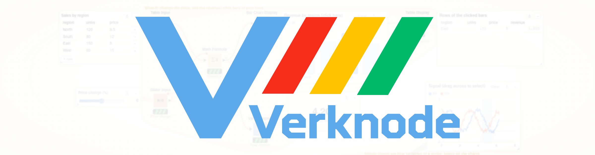
  </picture>

  <b>Visual, node-based data workflows for Python, inside JupyterLab.</b>

  <a href="https://verknode-project.github.io/verknode-preview/lab/index.html?path=examples/demo.vkf"><b>▶ Try the live demo</b></a>
  - in your browser, nothing to install

Build data pipelines by connecting nodes on a canvas: read files, clean and
reshape tables, run statistics and machine learning, draw charts, work with
molecules - and see every intermediate result. Tables flow between nodes as
[polars](https://pola.rs) DataFrames, workflows are saved with their data,
and everything stays scriptable from Python.

You can also build a workflow by chatting with an agent on the canvas, or let
your own agents build and run workflows over MCP. Any workflow exports as a
standalone Python script that runs without Jupyter.

## Highlights

- **About 300 nodes** for files, tables, dates, JSON / XML, statistics,
  scikit-learn models, databases, charts, loops, switches and error
  handling.
- **Web services, maps and diagrams** - curl and HTTP requests; Wikipedia,
  PubMed, OpenStreetMap, weather, podcasts and RSS / Atom feeds; ChEMBL, the
  PDB, UCSC Genome Browser, Ensembl and Gene Ontology. GIS nodes for
  GeoJSON, distances and points in polygons, an interactive map and Mermaid
  diagrams on the canvas.
- **Widgets on the canvas** - sliders, inputs and editable tables next to
  their nodes; tables and charts that update as you change them, and whose
  selections feed the rest of the workflow.
- **Walkthroughs** - a document that explains the workflow a section at a
  time, like a slide show, on the canvas or in a tab beside it. Its links
  show the nodes, groups, settings, widgets and outputs they name, and its
  buttons run them. Nodes and groups carry notes in Markdown, read by
  hovering their ¶. Agents write both as they build, so you can follow what
  they made.
- **See it run** - status lights, time bars with estimates, progress and the
  expected end of every node, loop iteration counters.
- **Tidy and fast at the keyboard** - auto layout that keeps groups together
  and untangles connections, alignment, and a canvas you can work from the
  keyboard: arrow keys between nodes, widgets that follow the selection, node
  settings and a node picker without touching the mouse.
- **Python all the way** - write nodes as Python classes, run notebooks as
  nodes, drive an open workflow from a notebook, export a workflow as a
  script - also a standalone one that runs without Jupyter, from a terminal,
  cron or CI.
- **Export anywhere** - a workflow (or one group of it) as a folder that
  runs on its own. Its requirements.txt holds only what it needs, measured
  by running it: a workflow of table nodes needs only polars. Headless
  exports drop the widgets and turn input widgets into parameters, and a
  Dockerfile and an HTTP API server can come with it.
- **An agent that builds the workflow with you** - describe what you need
  in a chat on the canvas. The agent finds node types, adds, configures and
  connects nodes, and tests them on a copy in a file sandbox before anything
  changes. It works only in its own group and asks before removing anything.
- **For your agents, too** - an MCP server (stdio, or live inside JupyterLab)
  lets Claude Code, Claude Desktop or any LLM build, run and read workflows:
  pipelines you can open and check rather than throwaway scripts, and
  reviewed workflows that agents run as tools with other parameters.
- **LLMs in the workflow** - prompt a local Ollama or any OpenAI-compatible
  server for every row: classify, summarize, extract typed fields; a chat
  that answers questions about the workflow's results, computing its numbers
  with SQL; summaries of tables by a prompt; a chatbot on the canvas; a small coding agent that writes code until hidden tests
  pass; manage Ollama's models and GPU memory.
- **Any model, one connection** - connector nodes for Ollama, inference
  servers (vLLM, SGLang, llama-server, LM Studio, TGI), commercial APIs
  (OpenAI, Gemini, Mistral, Groq, OpenRouter, ...), Claude, and GGUF models
  run in-process with llama.cpp, passed to the LLM nodes on an LLM port.
- **Agents you can measure** - data query agents built in the workflow with
  verknode's tool loop, LangGraph or Deep Agents; rubric-based evaluation,
  hill climbing on their instructions, multi-arm model comparison with
  bandits, and ablation studies;
  an LLM harness built as a workflow.
- **Runs in the browser, too** - a JupyterLite build with no server: the
  engine in WebAssembly Python, for trying, teaching and sharing.
- **Chemistry built in** - RDKit molecules as a column type, drawn as
  structures, with a structure sketcher; proteins and ligands in 3D with
  NGL or Mol*, in node views and on the canvas.
- **Packages** - sets of nodes, port types, widgets and editors that anyone
  can publish and users install from the package manager, kept up to date
  by themselves; the first is 3D printing: meshes, CAD files, a slicer,
  G-code, 3D viewers
  ([verknode-printing3d](https://github.com/verknode-project/verknode-printing3d)).

## A quick look

**Build workflows** from the node repository, with loops, switches and
groups outlined on the canvas:

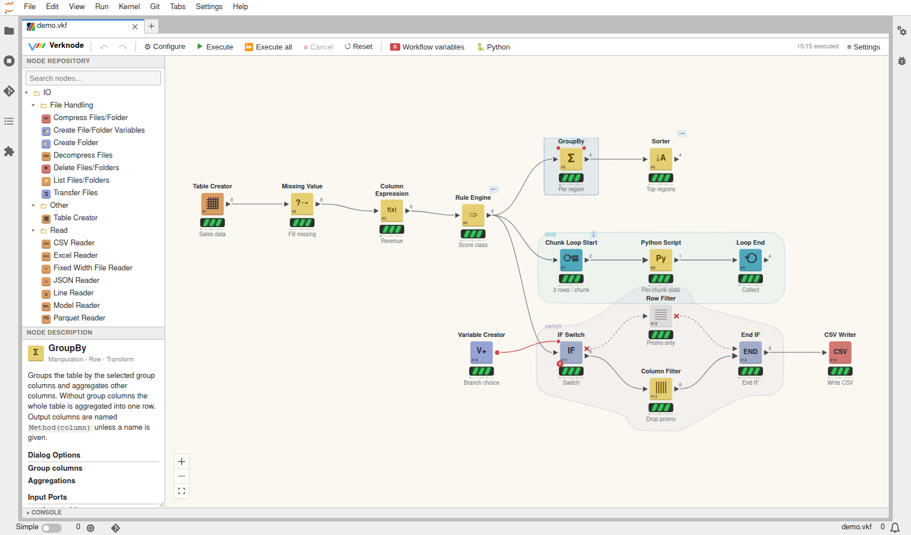

**Widgets on the canvas**: sliders and inputs next to their nodes, and
charts that update as you change them; clicking a bar selects its rows for
the rest of the workflow:

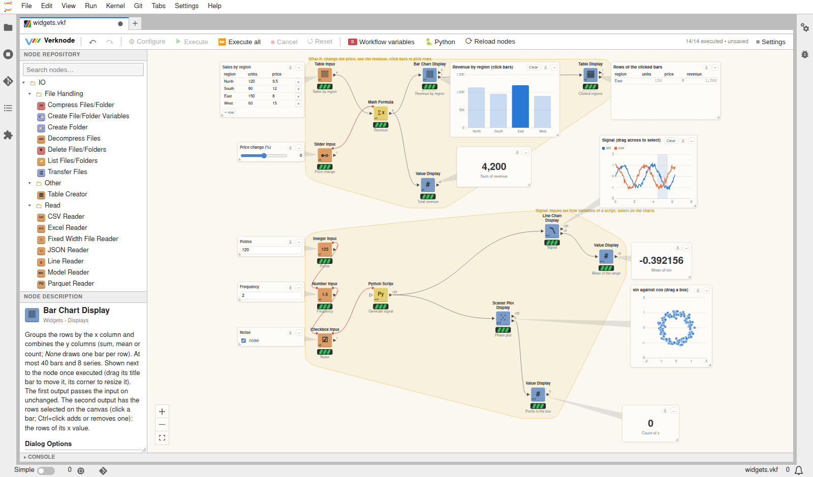

**Watch them run**: every node shows its run time, progress and when it
should be done; loops count their iterations:

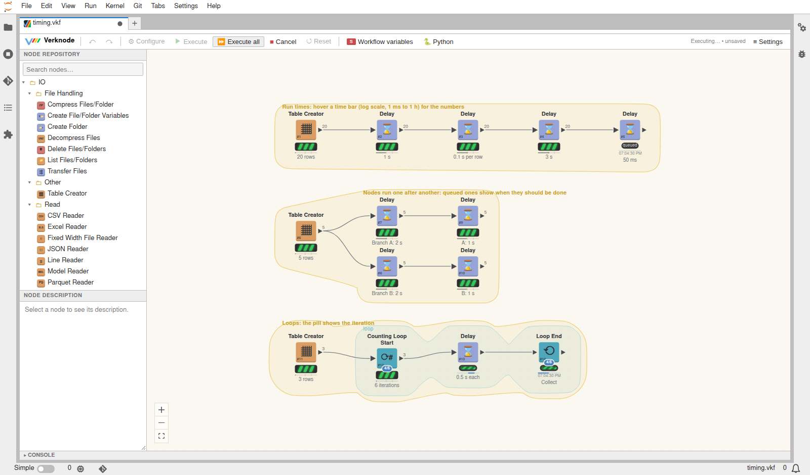

**Work from the keyboard, and tidy up in one step**: draw a selection by
double-clicking and holding on the empty canvas, align what you selected, and
let Auto Layout untangle the whole workflow. Then walk it with the arrow keys:
widgets follow the selection, and key hints appear at the bottom left once you
start.

| Keys | What they do |
|---|---|
| Arrow keys | Move the selection between nodes (Shift: extend it; Alt: follow the connections) |
| Enter | Widgets follow the selection: each node shows its widget, or a view of its result, as you reach it |
| Ctrl+Enter | Node settings; in the dialog, Tab, ← / →, Enter to apply and Esc to cancel all work |
| F7 / F8 | Execute / reset the selected nodes |
| Tab | Add a node: the next one after the selection, or at the pointer when nothing is selected |
| Ctrl+Shift+L | Auto Layout: the selected nodes, or the whole canvas |
| Ctrl+A | Select everything on the canvas |
| Double-click and hold, or Shift+drag | Draw a selection rectangle on the empty canvas |

**Look at any result**, including molecules drawn as structures:

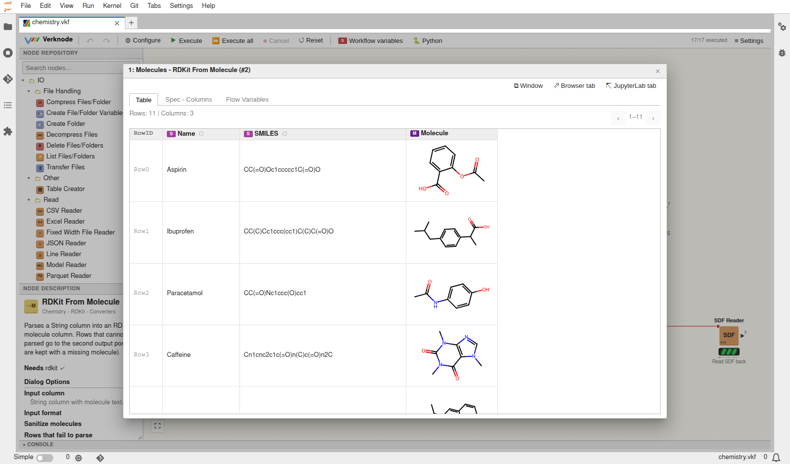

**Molecules in 2D and 3D**: pick ligand poses in a table of structures and
see them in the protein pocket (Mol*), or let RDKit generate 3D structures
from SMILES (NGL):

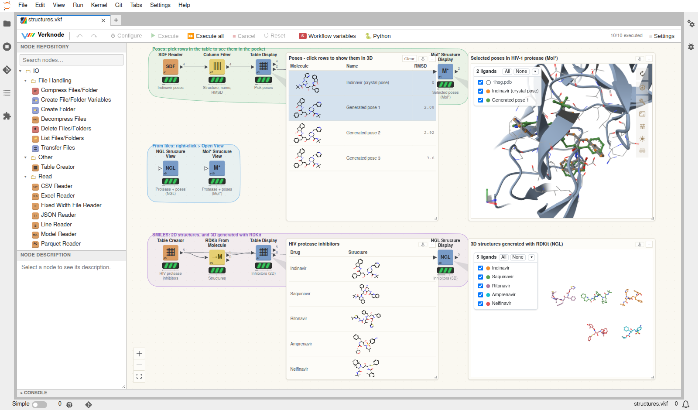

Turn and zoom them right on the canvas. Ctrl+click a row and that pose joins
the others in the pocket; tick the ligands to show, and click a name to zoom
to it:

**Build a workflow by chatting with an agent**: tell the Workflow Agent Chat
what you need ("total revenue per region, largest first", "as a bar chart").
For each message the model works with tools:
- it looks up node types and their settings;
- it adds, configures and connects nodes;
- it runs and previews them on a copy of the workflow, in a file sandbox,
  and fixes what fails.

Then the nodes appear in the agent's own group. Each reply lists the
changes and the first rows of the result. **Show changes** highlights them
on the canvas, and Tab adds the nodes you selected to your message.
Anything that undoes earlier work, like removing a node, waits for your
*Yes*. A finished chat can be resumed, or carried on in a second agent node
that takes the conversation as input:

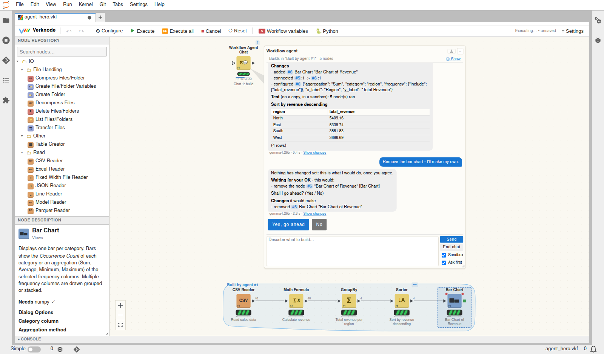

**Explain a workflow with a walkthrough**: a Walkthrough node holds a
Markdown document that you read a section at a time, like a slide show. It
sits on the canvas or in a JupyterLab tab beside it. Stepping to a section
shows what that section is about, and its links act on the workflow:
- a node or group link selects it and brings it into view;
- a settings link opens the node's settings at the setting it names;
- widget, output and view links show the chart or open the table;
- run buttons run a step, a group or the whole workflow.

**Notes on nodes and groups**: a ¶ after a node's label or a group's title
means it has a note. Hover the ¶ to read the note, or click it to edit,
with a live preview. Notes are Markdown and can point at other nodes (`#9`)
or settings, like a walkthrough:

You don't have to write them yourself:
- **The workflow agent** gives every node it adds a note, and its group one
  too. Once what it built works, it writes a walkthrough of it, and keeps
  the walkthrough up to date as the workflow changes.
- **Agents over MCP** are asked to do the same (`write_note`,
  `write_walkthrough`).
- **A Walkthrough node's own LLM** drafts the document for any workflow.

**Ask about the results**: a Data Q&A Chat answers questions about the
workflow's tables. The model computes every number it gives with SQL over
them, and says which node the answer comes from: hover the node number
(#6) for a look at its table, click it to keep the look. An LLM Summarizer turns
tables into a summary by a prompt, shown in a Text Display:

**Web services, maps and diagrams**: ask Wikipedia, OpenStreetMap, weather,
podcast, ChEMBL, PDB, Ensembl or Gene Ontology services for every row of a
table; put places in territories and on an interactive map, and select on
it; draw tables and LLM answers as Mermaid diagrams:

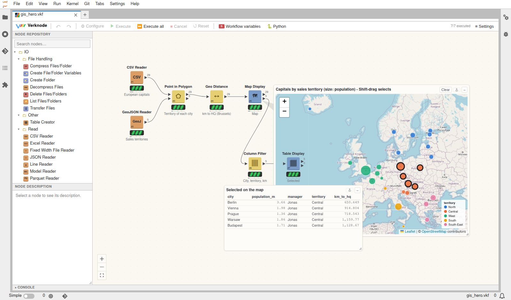

**Build agents, then measure and improve them**: a data query agent as
nodes (verknode's tool loop, LangGraph or Deep Agents), scored with a
rubric. In this run, hill climbing took it from 0.75 to 0.99: the proposer
found, with SQL, that revenue is amount × quantity. Multi-arm evaluation
compares models, and an ablation study shows what each part of the agent
is worth:

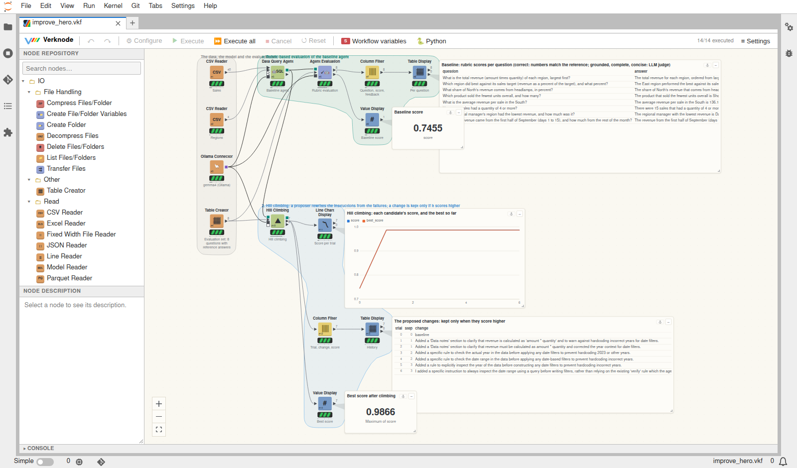

**An LLM harness as a workflow**: the loop around a model as nodes. LLM
Step calls the model; Tool Policy allows or denies its tool calls; Tool
Executor runs SQL, sandboxed Python, reviewed verknode workflows and HTTP as
tools; Context Window keeps the context within budget. The trace is a table:

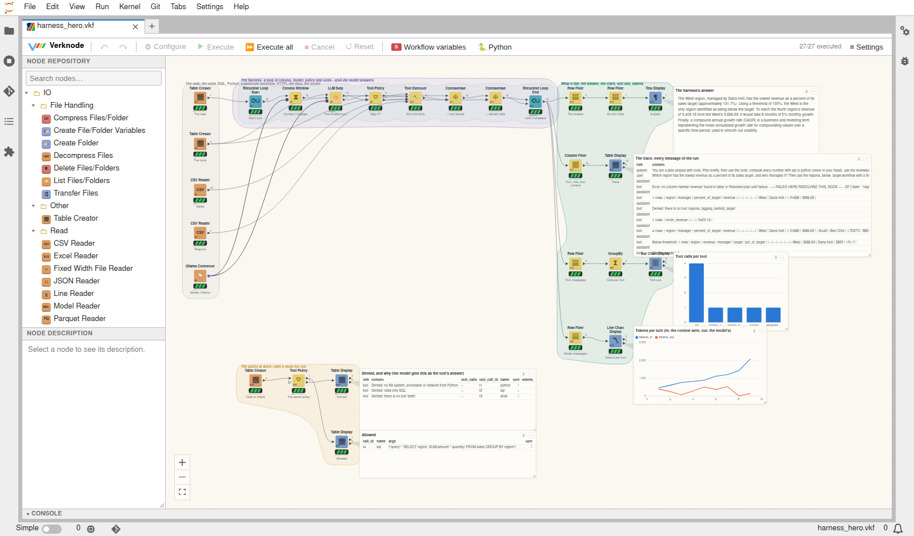

**Chat with a model** right on the canvas: a Chat Loop Start waits for your
message, a local LLM answers (here with Ollama), and the conversation goes
round the loop again - it keeps growing, and answers can come from your
tables:

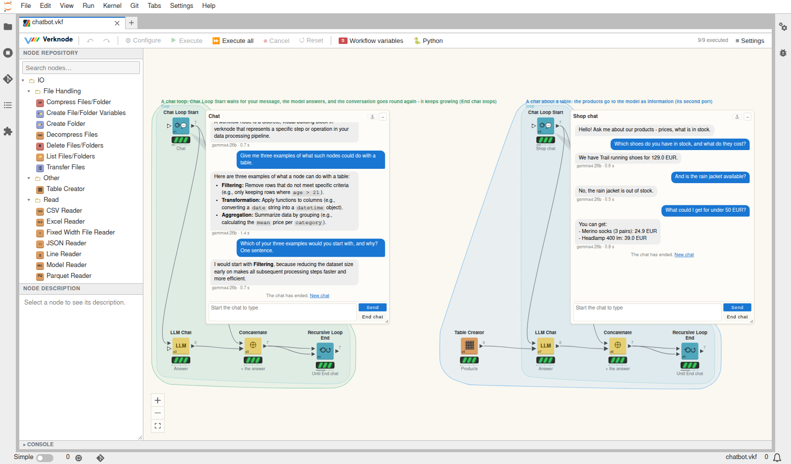

**Let a model write code** until hidden tests pass: a small coding agent made
of ordinary nodes - the model writes the code, the Python Code Runner tests
it, and each failing case goes back to the model:

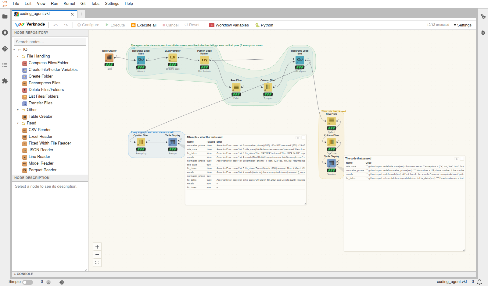

## Packages

verknode grows with **packages**: optional sets of nodes, port types,
canvas widgets, editors and example workflows. You install the ones you
want from **≡ Settings › Packages**. They work at once, without a restart,
and they stay up to date by themselves.

**3D printing** ([verknode-printing3d](https://github.com/verknode-project/verknode-printing3d)),
the first package:
- **Files:** meshes and CAD files (STL, OBJ, PLY, 3MF, GLB, STEP, IGES,
  DXF).
- **Modelling:** shapes, booleans, extrusions, repair, OpenSCAD.
- **Printing:** a slicer, and G-code as a table of moves.
- **On the canvas:** 3D viewers, and an editor that places the part on the
  build plate.

| Package | What it adds | Install |
|---|---|---|
| [3D Printing](https://github.com/verknode-project/verknode-printing3d) (`printing3d`) | 18 nodes: mesh and CAD readers and writers, modelling, a slicer, G-code, 3D viewers and an editor; the `mesh` port; a printer profile; an example workflow | ≡ Settings › Packages › Install |

## Try it

**[Open the live demo](https://verknode-project.github.io/verknode-preview/lab/index.html?path=examples/demo.vkf)**: verknode in JupyterLite, running entirely
in your browser with no server and nothing to install. The workflow engine
runs in a Pyodide (WebAssembly Python) kernel in the page, and your files
stay in your browser.

- The first start takes 15 to 30 seconds while the browser loads Python and
  its packages; later visits use the cache.
- The example workflows are in the file browser, in folders by topic; the
  demo opens `examples/demo.vkf`.
- Most nodes work in the browser. Chats with local models, RDKit, SQLite
  files and nodes that start processes need a full install.

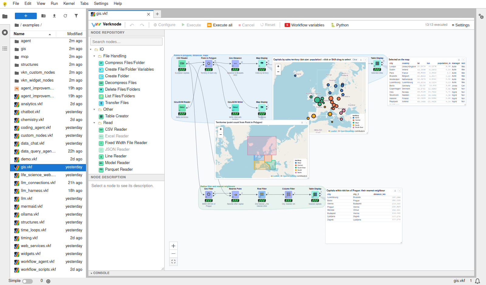

## About this repository

This repository is a preview of verknode: screenshots and a live demo. The
source code is not public.
